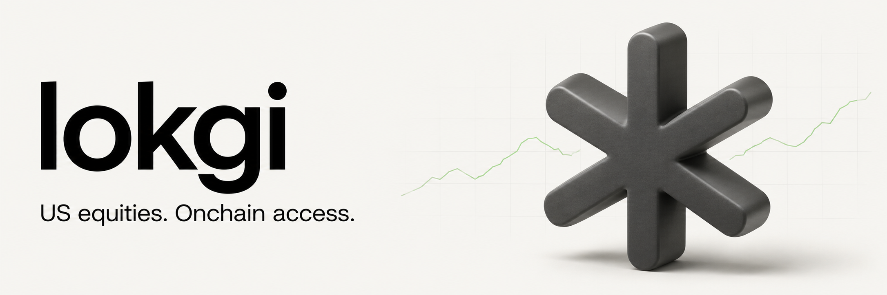
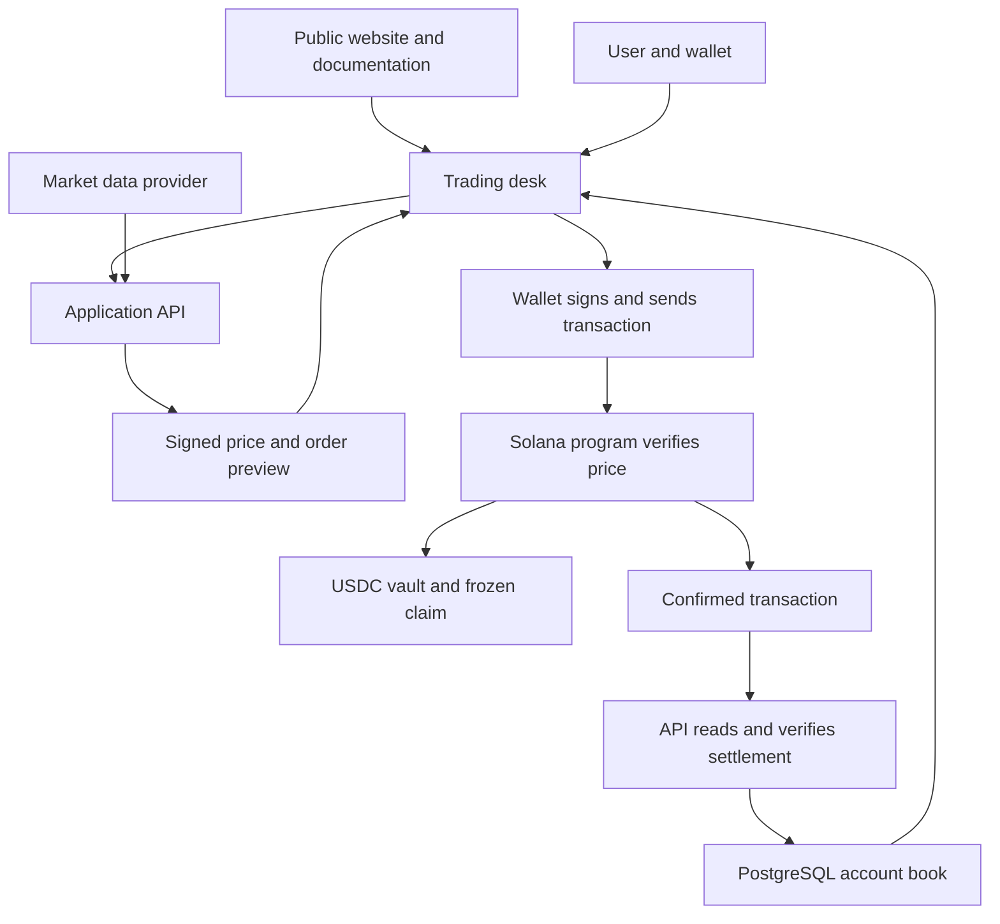

<p align="center">
  
</p>

<p align="center">
  <strong>US market discovery. Wallet-connected portfolios. USDC settlement on Solana.</strong>
</p>

<p align="center">
  <a href="https://www.lokgi.com">Website</a> ·
  <a href="https://app.lokgi.com">Open the desk</a> ·
  <a href="https://www.lokgi.com/docs">Documentation</a> ·
  <a href="https://www.lokgi.com/litepaper">Litepaper</a> ·
  <a href="https://github.com/lokgi-hq/lokgi/issues">Feedback</a>
</p>

# We're building Lokgi

## What this is and who it's for

Lokgi is a reference desk for US-listed companies, bringing market discovery, wallet-connected portfolios, and USDC-vault claims into one product. It is built for people who want to research US companies and understand the price, fee, wallet action, and settlement behind a position.

A Lokgi claim records USDC held in a program vault against a referenced company at the price used for the order. It does not represent company shares, dividends, voting rights, or a right to redeem for stock.

This organization hosts our public work. The [`lokgi` repository](https://github.com/lokgi-hq/lokgi) contains the website and documentation; the trading application is a separate service.

## Story & inspiration

Lokgi starts with a simple idea: a familiar company name should lead to a clear explanation of what a user can actually do—and what they will hold afterward.

A stock chart, a wallet signature, and an onchain token describe different things. Our product brings them into one workflow while keeping those distinctions visible: the US listing supplies the reference price, the wallet authorizes a transaction, and the vault claim records what settles.

That idea shapes our approach: explicit price labels, readable transaction previews, verifiable settlement, and documentation that explains the claim before asking someone to use it.

## Problem

- **Market information and transaction context are fragmented.** Research, wallet activity, and portfolio records often live in separate places.
- **A chart does not explain ownership.** Users need to understand the difference between a company share and a price-linked vault claim.
- **Transaction status can be unclear.** A submitted signature needs to be distinguished from a confirmed and reconciled fill.
- **Price quality needs context.** An official close, a live quote, and a cached stale price should be labelled differently.

## Solution

Lokgi combines a searchable US-company directory, clearly labelled reference prices, an order preview, wallet authorization, and an account book updated after settlement is verified.

Our guiding rule is straightforward: **show what is referenced, explain what is held, and record what actually settled.**

## How it works

The workflow below is described in our [product documentation](https://github.com/lokgi-hq/lokgi/blob/main/lib/docs.ts) and [litepaper source](https://github.com/lokgi-hq/lokgi/blob/main/app/litepaper/page.tsx):

1. **Discover a company.** Search the US directory and inspect its reference price and chart. An order ticket is available only for names with a supported Lokgi mint.
2. **Sign in and connect a wallet.** Email-code sign-in establishes an account; a wallet message binds the wallet to it. That message does not authorize a trade.
3. **Review the order.** The server prepares a signed price and a preview showing the amount, quantity, and fee. The documented preview lifetime is 60 seconds.
4. **Authorize settlement.** The wallet signs the transaction. The program checks the signed price before moving USDC.
5. **Receive or redeem a claim.** A buy deposits USDC and mints a frozen claim. A sell burns the claim and returns USDC under the program's rules.
6. **Verify and record.** The API reads the landed transaction before booking the fill and updating portfolio records.

Current website documentation describes Solana mainnet settlement.

## Target users

- **US-market researchers** exploring company profiles, reference prices, and market context.
- **Solana wallet users** seeking a clear explanation of USDC-based vault claims and settlement.
- **Portfolio users** who want holdings, cost basis, transaction history, and cash movement in one workflow.
- **Developers and ecosystem collaborators** interested in transparent order states, price verification, and settlement reconciliation.

These are intended audiences, not a claim about current user counts or availability in any jurisdiction.

## Features

| Area | What Lokgi describes or provides |
| --- | --- |
| Market discovery | Searchable US listings, company views, reference prices, and charts. |
| Supported claims | The documentation describes more than 100 names with a mint and order ticket; the wider directory is available for research. |
| Price context | Official-close labels, stale-data handling, and signed order prices. |
| Account access | Email-code sign-in and wallet-message authentication. |
| Orders | Fee and quantity previews, expiring quotes, and wallet-signed transactions. |
| Settlement | USDC vault movement and minting or burning of frozen claims. |
| Portfolio | Documented cost basis, realized and unrealized results, history, and exports. |
| Public resources | Website, docs, litepaper, terms, privacy policy, and risk disclosure. |
| Staking interface | A local illustrative preview; it does not lock tokens, transfer funds, or pay rewards. |

Product capabilities above describe the published documentation. The public website repository does not contain the trading backend or Solana program implementation.

<!-- Add this section when confirmed details are supplied.
## Addresses & revenue

| Item | Disclosure |
| --- | --- |
| Network | Solana mainnet, as described in current product documentation. |
| Program ID and explorer link | Pending verified publication. |
| Vault and treasury addresses | Pending verified publication. |
| Supported claim mints | Pending verified address registry. |
| Protocol revenue | Not disclosed in the reviewed public materials. |
| Trading volume, active users, and TVL | Not disclosed in the reviewed public materials. |

The litepaper specifies an order fee of **10 basis points (0.10%)**. That fee schedule is not evidence of revenue earned. Any future revenue disclosure should include its reporting period, calculation, and supporting transactions or dashboard.
-->

## Ecosystem & integrations

The following technologies appear in the code or product documentation. Inclusion does not imply sponsorship, endorsement, or a formal partnership.

| Technology | Role | Evidence |
| --- | --- | --- |
| Solana | Documented settlement network for USDC and vault claims. | [Settlement docs](https://github.com/lokgi-hq/lokgi/blob/main/lib/docs.ts) |
| USDC | Documented settlement and vault denomination. | [Litepaper](https://github.com/lokgi-hq/lokgi/blob/main/app/litepaper/page.tsx) |
| Phantom / Solflare | Wallets named in the documented connection flow. | [Wallet docs](https://github.com/lokgi-hq/lokgi/blob/main/lib/docs.ts) |
| Massive | Documented source of market aggregates and official-close data. | [Pricing design](https://github.com/lokgi-hq/lokgi/blob/main/app/litepaper/page.tsx) |
| Vercel Analytics | Analytics component included in the website layout. | [Website layout](https://github.com/lokgi-hq/lokgi/blob/main/app/layout.tsx) |

<!-- Add confirmed sponsors and formal partners with public evidence when supplied. -->

## Tech stack

| Layer | Stack and evidence |
| --- | --- |
| Website | Next.js 16, React 19, TypeScript. |
| Interface | Tailwind CSS 4, Radix UI, Lucide icons, locally hosted Switzer fonts. |
| Content | Next.js App Router pages and TypeScript documentation content. |
| Backend | The existing organization profile names Hono; backend source is not present in the reviewed website repository. |
| Account book | Product documentation describes PostgreSQL for accounts, orders, fills, and saved prices. |
| Settlement | Documentation describes a native Solana program, USDC vaults, and frozen claim tokens. |

See the [website dependencies](https://github.com/lokgi-hq/lokgi/blob/main/package.json) for the installed frontend stack.

## Architecture

The public website is a separate application from the trading desk. The following diagram summarizes the trading design described in the litepaper; it is not a deployment inventory.



The chain establishes whether funds moved. The account book records a fill after verification. The browser displays the result and prepares the next action.

## Competitors & alternatives

We think about alternatives by the user need they serve. This is a positioning framework, not a verified comparison of individual providers.

| Alternative | User need | Lokgi's intended focus |
| --- | --- | --- |
| Brokerage platforms | Access to actual securities and shareholder rights, subject to the provider's terms. | Clearly explained USDC-vault claims referenced to US listings. |
| Market research tools | Company discovery, charts, and reference data. | Bringing research context into the claim and settlement workflow. |
| Tokenized-equity products | Onchain instruments whose ownership and redemption rights vary. | Explicit disclosure of what a Lokgi claim represents. |
| Synthetic exposure protocols | Price-linked positions under protocol-specific rules. | A company-focused desk with a documented close-price and settlement flow. |

## Go to market

**Proposed approach:**

1. Publish short explainers showing the complete path from company research to a reconciled vault claim.
2. Invite a focused group of Solana wallet users to test onboarding, quote clarity, and transaction status.
3. Use feedback to improve the desk and publish clear eligibility, supported assets, and deployment details.
4. Expand through developer demos, educational content, and confirmed ecosystem collaborations.

Track activation, successful settlement, reconciliation failures, repeat use, and support burden. No acquisition results are claimed here.

## Business model

The documented model charges a **0.10% fee on order notional**, using integer micro-units and truncation as specified in the litepaper. Solana network fees are separate and paid in SOL by the user's wallet.

<!-- Add verified revenue, fee distribution, and any additional business lines when supplied. -->

## Roadmap

This is a proposed sequence, not a dated delivery commitment.

| Stage | Focus | Status |
| --- | --- | --- |
| Public foundation | Website, documentation, litepaper, and legal pages. | Present in the public website repository. |
| Deployment transparency | Publish verified program, vault, and mint addresses and supporting explorer links. | Proposed. |
| Verification | Publish backend/program source or verification artifacts, test results, and security-review scope. | Proposed. |
| Product validation | Test onboarding and order reconciliation with a focused user group. | Proposed. |
| Growth | Refine activation and retention using observed user feedback. | Proposed. |

<!-- Add this section when confirmed details are supplied.
## Team

We are building Lokgi around clear market information, thoughtful interfaces, and transactions users can verify.

Team names, roles, biographies, and approved profile links are pending publication. Repository contributions can be explored through the [organization's public repositories](https://github.com/orgs/lokgi-hq/repositories); contribution history alone does not establish a founder or team role.
-->

## Run locally

These commands run the public website and documentation. Use Node.js 20.9 or newer and npm.

```bash
git clone https://github.com/lokgi-hq/lokgi.git
cd lokgi
npm ci
npm run dev
```

Open [localhost:3000](http://localhost:3000). The website needs no environment variables for local development. These steps do not start the trading backend or deploy a Solana program.

## Verify / tests

```bash
# Build the website
npm run build

# Serve the resulting build
npm start
```

Check the homepage, docs, litepaper, staking preview, and legal pages. Confirm that navigation and external application links work on desktop and mobile.

The current repository has no automated test script. Its lint script references ESLint without a corresponding installation or configuration, and the Next.js configuration skips TypeScript build errors. A successful build verifies compilation and page generation; it does not establish type correctness, backend correctness, or program security.

## Repo layout

In [`lokgi-hq/lokgi`](https://github.com/lokgi-hq/lokgi):

```text
app/                    Pages, layouts, and global styles
  docs/                 Documentation routes
  litepaper/            Litepaper
  stake/                Illustrative staking preview
  terms/                Terms of use
  privacy/              Privacy policy
  risk-disclosure/      Risk disclosure
components/             Website sections and shared UI
  cest-hero/            Standalone hero source project
fonts/                  Local font files
hooks/                  Shared React hooks
lib/docs.ts             Documentation content and navigation
public/                 Images, icons, and video
docs/assets/            Repository banner
```

## Security notes

- A wallet-binding message and a funds-moving transaction are separate approvals. Read the wallet prompt before signing.
- Lokgi documentation says it never asks for a seed phrase. Do not share private keys or recovery phrases.
- Verify the network, mint, program, amount, and fee against official published deployment details before moving funds.
- The documented design uses signed prices, expiring previews, and settlement readback. Documentation is not an independent audit.
- A claim depends on the vault, program, and pricing rules. It provides no company-share ownership rights.
- The staking page is illustrative. Its displayed rewards are not paid, and it sends no transaction.
- Never place credentials or sensitive vulnerability details in public issues.

Read the [risk disclosure](https://www.lokgi.com/risk-disclosure) and [terms](https://www.lokgi.com/terms). The reviewed materials do not establish an independent audit, regulatory approval, or a security guarantee.

## License

The reviewed `lokgi` repository does not specify a license. Public source visibility does not grant an open-source license. Check each repository for its own license before reusing code or assets.

<!-- Add this section when confirmed details are supplied.
## Previous hackathon wins

No verified hackathon wins were identified in the reviewed public materials. This is not a claim that the team has never won an award.

When available, publish the event, year, project, award or track, and an official results link.
-->

<!-- Add this section when confirmed details are supplied.
## Previous grants taken

No verified grant history was identified in the reviewed public materials. This is not a claim that the team has never received funding.

When available, publish the grantor, program, recipient project, date, amount if public, and an official announcement or grant record.
-->

<!-- Add this section when confirmed details are supplied.
## Public mentions & endorsements

Verified third-party post links are pending. We will attribute each mention to its author and link directly to the original post. A mention does not automatically imply an endorsement, investment, or partnership.
-->

<!--
25. Token flywheel — publish only after a confirmed token launch.
Explain actual token utility, the source and destination of value flows,
incentive funding, governance rights if any, and risks. Link to implemented
mechanisms and avoid implying guaranteed returns or unapproved revenue sharing.

26. Token details — publish only after a confirmed token launch.
Include the official name and symbol, network, verified mint and explorer link,
decimals, supply, mint/freeze authorities, allocations, vesting, and utility.
Distinguish any project token from the frozen vault-claim tokens and USDC.
Do not treat the staking preview or its third-party chart as launch evidence.
-->

---

Want to help make market information and onchain settlement easier to understand? Explore our [public repositories](https://github.com/orgs/lokgi-hq/repositories), read the [docs](https://www.lokgi.com/docs), or [share focused product feedback](https://github.com/lokgi-hq/lokgi/issues).
